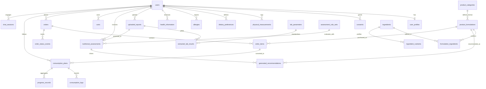

# NutriAI – Database Architecture & Schema Specification

## 1. Overview
NutriAI employs **PostgreSQL 15+** with the following core architectural rules:
- **UUID Primary Keys** for all relational entities (`uuid_generate_v4()`).
- **Timestamps** (`created_at`, `updated_at` with time zone) on all tables.
- **Append-Only History**: Lab reports, extracted results, clinical assessments, generated formulations, and consumption logs are immutable. New assessments create new records with foreign key links to rule set versions.
- **Soft Deletion**: `deleted_at timestamptz` for user-deletable assets.
- **Column-Level Encryption**: AES-256-GCM for sensitive health fields (diagnoses, medications, notes).
- **Trigram Search & Unaccent**: `pg_trgm` for multilingual ingredient alias search.

---

## 2. Entity-Relationship (ER) Diagram



---

## 3. Table Catalog & Columns

1. **`users`**:
   - `id` (UUID PK), `auth_uid` (unique), `auth_provider` (`supabase`, `firebase`, `dev`), `email` (unique, citext), `email_verified` (bool), `role` (`user`, `admin`, `nutritionist`), `preferred_language` (`en`, `ta`, `hi`, `te`, `ml`), `date_of_birth` (date), `status` (text), `guardian_consent_id` (UUID FK nullable), `created_at`, `updated_at`, `deleted_at`.
   - *Note*: Age is never stored; computed dynamically from `date_of_birth`.

2. **`user_profiles`**:
   - `id` (UUID PK), `user_id` (UUID FK unique), `full_name` (text), `sex` (text), `phone` (text), `address_line` (text), `city` (text), `state` (text), `pin_code` (varchar(6), check regex `^[1-9][0-9]{5}$`), `profile_completion_pct` (int).

3. **`consents`**:
   - `id` (UUID PK), `user_id` (UUID FK), `subject_type` (`self`, `guardian`), `guardian_name` (text), `guardian_relation` (text), `guardian_contact` (text), `purpose` (`data_processing`, `health_data`, `report_ocr`, `chatbot`), `granted` (bool), `policy_version` (text), `granted_at`, `revoked_at`.

4. **`physical_measurements`**:
   - `id` (UUID PK), `user_id` (UUID FK), `measured_on` (date), `height_cm` (numeric 30-250), `weight_kg` (numeric 10-250), `bmi` (numeric computed), `source` (text), `created_at`. Append-only.

5. **`dietary_preferences`**:
   - `id` (UUID PK), `user_id` (UUID FK), `diet_type` (`vegetarian`, `eggetarian`, `non_vegetarian`, `vegan`, `jain`, `other`), `disliked_foods` (text[]), `favourite_foods` (text[]), `meals_per_day` (int), `eating_pattern_notes` (text), `budget_per_serving_inr` (numeric), `preferred_format_ids` (text[]), `effective_from` (timestamptz). Versioned.

6. **`allergies`**:
   - `id` (UUID PK), `user_id` (UUID FK), `allergen_code` (text), `kind` (`allergy`, `intolerance`, `restriction`), `severity` (text), `is_active` (bool), `recorded_on` (timestamptz).

7. **`health_information`**:
   - `id` (UUID PK), `user_id` (UUID FK), `recorded_on` (timestamptz), `known_deficiencies` (text[]), `diagnoses_encrypted` (text), `pregnancy_status` (text), `menstrual_info_encrypted` (text), `supplements_encrypted` (text), `medications_encrypted` (text), `notes_encrypted` (text).

8. **`uploaded_reports`**:
   - `id` (UUID PK), `user_id` (UUID FK), `storage_key` (text), `original_filename` (text), `mime_type` (text), `size_bytes` (bigint), `sha256` (text), `report_date` (date nullable), `lab_name` (text nullable), `ocr_engine` (text), `ocr_status` (`uploaded`, `processing`, `needs_review`, `confirmed`, `failed`), `raw_ocr` (jsonb), `uploaded_at`, `deleted_at`.

9. **`lab_parameters`**:
   - `id` (UUID PK), `code` (text unique: `HB`, `FERRITIN`, `SERUM_IRON`, `TIBC`, `TSAT`, `MCV`, `MCH`, `MCHC`, `RDW`, `B12`, `FOLATE`, `VITD`), `display_name` (jsonb: en, ta, hi, te, ml), `canonical_unit` (text), `allowed_units` (jsonb with conversion factors), `plausible_min` (numeric), `plausible_max` (numeric), `aliases` (text[]).

10. **`extracted_lab_results`**:
    - `id` (UUID PK), `report_id` (UUID FK), `user_id` (UUID FK), `parameter_id` (UUID FK nullable), `raw_name` (text), `raw_value` (text), `value_numeric` (numeric nullable), `unit` (text), `canonical_value` (numeric nullable), `ref_low` (numeric nullable), `ref_high` (numeric nullable), `flag` (text), `ocr_confidence` (numeric), `needs_review` (bool), `user_corrected` (bool), `original_ocr_value` (text), `confirmed_at` (timestamptz nullable).

11. **`nutrient_reference_values`**:
    - `id` (UUID PK), `nutrient_code` (text), `life_stage` (text), `value` (numeric), `unit` (text), `source_document` (text), `source_page` (text), `version` (text), `effective_from` (date), `effective_to` (date nullable), `reviewed_by` (text nullable), `reviewed_at` (timestamptz nullable), `status` (`draft`, `expert_approved`).

12. **`assessment_rule_sets`**:
    - `id` (UUID PK), `version` (text unique), `rules` (jsonb), `status` (`draft`, `expert_approved`, `retired`), `approved_by` (text nullable), `approved_at` (timestamptz nullable).

13. **`nutritional_assessments`**:
    - `id` (UUID PK), `user_id` (UUID FK), `report_id` (UUID FK nullable), `measurement_id` (UUID FK nullable), `diet_pref_id` (UUID FK nullable), `rule_set_id` (UUID FK), `reference_set_version` (text), `age_years_at_assessment` (numeric), `life_stage` (text), `findings` (jsonb), `nutrient_targets` (jsonb), `safety_status` (`ok`, `caution`, `refer_to_doctor`, `blocked`), `safety_messages` (jsonb), `created_at`. Append-only.

14. **`ingredients`**:
    - `id` (UUID PK), `name` (text), `local_names` (jsonb), `category` (text), `diet_class` (text), `allergens` (text[]), `cost_per_kg_inr` (numeric), `cost_as_of` (date), `availability` (text), `processing_notes` (text), `bioavailability_notes` (text), `shelf_life_notes` (text), `min_inclusion_pct` (numeric), `max_inclusion_pct` (numeric), `data_status` (`draft`, `verified`), `version` (int).

15. **`ingredient_nutrients`**:
    - `id` (UUID PK), `ingredient_id` (UUID FK), `nutrient_code` (text), `amount_per_100g` (numeric), `unit` (text), `source` (`IFCT_2017`, `ICMR_NIN`, `USDA`, `label`, `other`, `PLACEHOLDER_DEMO`), `source_ref` (text), `is_heme_iron` (bool), `verified_by` (text nullable), `verified_at` (timestamptz nullable). Unique `(ingredient_id, nutrient_code, source)`.

16. **`product_categories`**:
    - `id` (UUID PK), `slug` (text unique: `bars`, `laddoos`, `breakfast_mix`, `beverage_mix`, `chikkis`), `name` (jsonb), `format_template` (jsonb: serving size, allowed ingredient categories, binder rules), `description` (jsonb).

17. **`product_formulations`**:
    - `id` (UUID PK), `formulation_code` (text), `version` (int), `category_id` (UUID FK), `serving_size_g` (numeric), `nutrient_results_per_serving` (jsonb), `cost_per_serving_inr` (numeric), `cost_per_pack_inr` (numeric), `pack_size_servings` (int), `solver_status` (text), `constraints_snapshot` (jsonb), `validation_status` (`computed_only`, `expert_reviewed`, `lab_validated`), `preparation_instructions` (jsonb), `storage_instructions` (jsonb). Unique `(formulation_code, version)`.

18. **`formulation_ingredients`**:
    - `id` (UUID PK), `formulation_id` (UUID FK), `ingredient_id` (UUID FK), `ingredient_version` (int), `grams_per_serving` (numeric), `pct_of_mix` (numeric), `purpose` (`iron_source`, `absorption_enhancer`, `folate_source`, `b12_source`, `protein`, `binder`, `flavour`, `bulk`), `rationale_code` (text).

19. **`generated_recommendations`**:
    - `id` (UUID PK), `user_id` (UUID FK), `assessment_id` (UUID FK), `formulation_id` (UUID FK), `rank` (int), `why_selected` (jsonb), `explanation_text` (jsonb), `saved` (bool), `generated_at` (timestamptz).

20. **`carts` & `cart_items`**:
    - `carts`: `id` (UUID PK), `user_id` (UUID FK unique), `updated_at`.
    - `cart_items`: `id` (UUID PK), `cart_id` (UUID FK), `formulation_id` (UUID FK), `quantity` (int).

21. **`orders` & `order_items` & `order_status_events`**:
    - `orders`: `id` (UUID PK), `order_number` (text unique, e.g. `NAI-2026-000123`), `user_id` (UUID FK), `status` (`pending`, `confirmed`, `processing`, `shipped`, `delivered`, `cancelled`), `subtotal` (numeric), `delivery_fee` (numeric), `total` (numeric), `shipping_address` (jsonb), `payment_mode` (`demo_sandbox`), `is_prototype` (bool default true), `created_at`.
    - `order_items`: `id` (UUID PK), `order_id` (UUID FK), `formulation_id` (UUID FK), `product_name` (text), `unit_price` (numeric), `quantity` (int), `total_price` (numeric).
    - `order_status_events`: `id` (UUID PK), `order_id` (UUID FK), `status` (text), `note` (text), `created_at`.

22. **`consumption_plans`, `consumption_logs`, `progress_records`, `reminders`**:
    - Adherence tracking, daily intake logs (`plan_id + logged_on` unique), lab comparisons over time.

23. **`chat_sessions` & `chat_messages`**:
    - `chat_sessions`: `id` (UUID PK), `user_id` (UUID FK), `scope` (`general`, `personalized`), `language` (text).
    - `chat_messages`: `id` (UUID PK), `session_id` (UUID FK), `role` (`user`, `assistant`), `content` (text), `grounding` (jsonb), `safety_flags` (jsonb), `input_mode` (`text`, `voice`).

24. **`statistics`, `educational_content`, `audit_logs`, `contact_messages`**:
    - Epidemiological metrics (verified/pending), multilingual learning modules, immutable compliance audit log.

---

## 4. IFCT CSV Import Format
When importing verified data using `python -m app.seed.import_ifct data.csv`, the CSV columns are:
```csv
code,name,local_name_hi,local_name_ta,category,diet_class,energy_kcal,protein_g,iron_mg,folate_ug,b12_ug,vit_c_mg,calcium_mg,fat_g,added_sugar_g,sodium_mg,fibre_g,phytate_flag,source_ref
```

